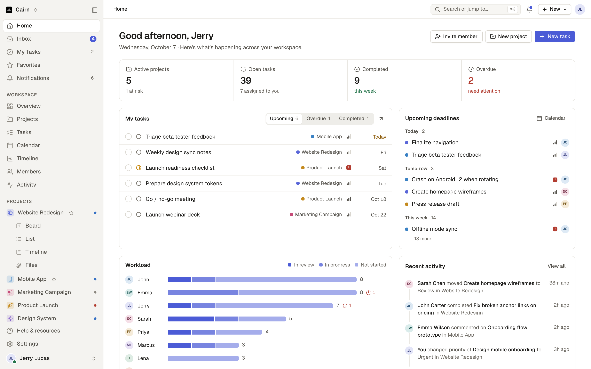
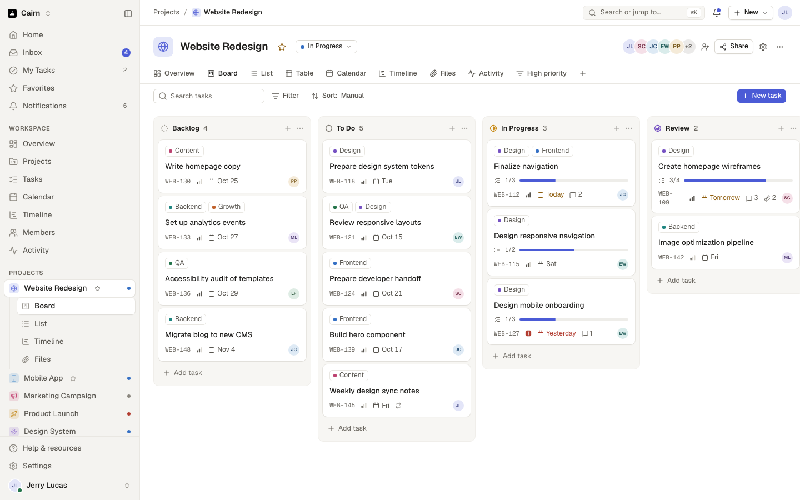
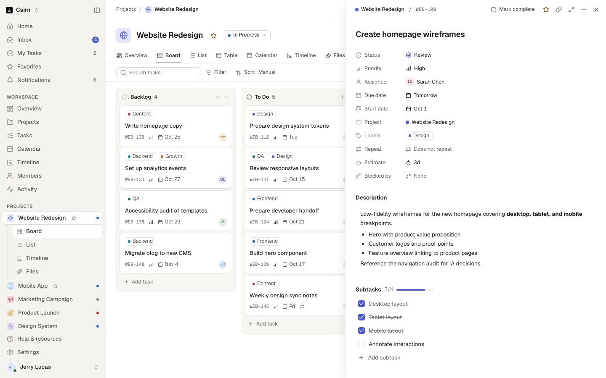
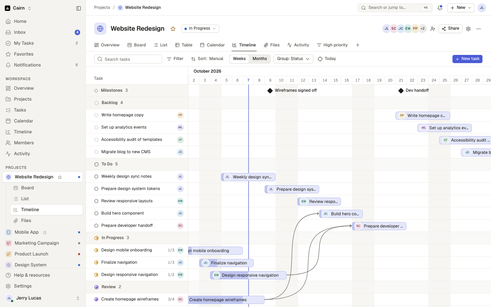
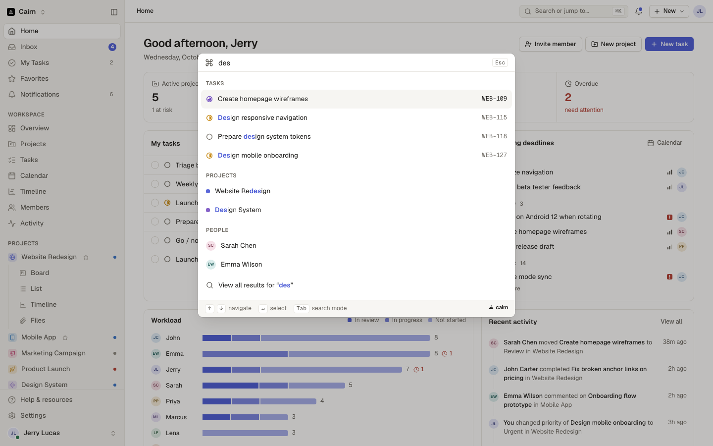

<p align="center">
  
</p>

<h1 align="center">Cairn</h1>

<p align="center">
  <strong>A calm project management workspace that runs entirely in the browser.</strong><br>
  Boards, lists, timelines and a fast command menu. No server, no sign-up.
</p>

<p align="center">
  <a href="https://github.com/CollatzConjecture/cairn/actions/workflows/ci.yml"></a>
  <a href="LICENSE"></a>
</p>

<picture>
  <source media="(prefers-color-scheme: dark)" srcset="docs/preview-dark.png">
  
</picture>

A cairn is a stack of stones that marks a trail. Cairn does the same for a team's work by keeping milestones, deadlines and who is doing what in view. Everything is saved in your browser, and the first visit opens a demo workspace you can explore, change and reset.

## A one-minute tour

https://github.com/user-attachments/assets/44478d21-0c91-4a0d-b4a6-216c97ef72f1

## Features

### Projects your way

- **Eight views of every project.** Overview, Board, List, Table, Calendar, Timeline, Files and Activity.
- **Filter, sort, group and search** any view, then save the result as its own view tab.
- **Drag and drop** cards between board columns, rows within a list, tasks between calendar days, and timeline bars to new dates.
- **Milestones and dependencies** on the timeline, with an arrow from each blocker to the task it blocks.

### Tasks with the details that matter

- Status, priority, assignee, start and due dates, labels, estimates and repeat rules.
- Subtasks, blockers, file attachments, and comments with @mentions and emoji reactions.
- Open a task in a side panel or as a full page, or select several and change them at once.

### The whole workspace at a glance

- **Home** shows your tasks, upcoming deadlines, team workload, recent activity and project progress.
- **Inbox** collects mentions, assignments and comments. Notifications, favorites, search, and a workspace-wide calendar and timeline sit beside it.
- **Members and teams** with roles and per-role permissions.

### Fast from the keyboard

| Keys                                                                                            | Action                                                              |
| ----------------------------------------------------------------------------------------------- | ------------------------------------------------------------------- |
| <kbd>⌘</kbd> <kbd>K</kbd>                                                                       | Command menu: jump to any task, project or person, or run a command |
| <kbd>/</kbd>                                                                                    | Search                                                              |
| <kbd>N</kbd> / <kbd>P</kbd>                                                                     | New task / new project                                              |
| <kbd>G</kbd> then <kbd>H</kbd> <kbd>T</kbd> <kbd>P</kbd> <kbd>I</kbd> <kbd>C</kbd> <kbd>S</kbd> | Go to Home, My Tasks, Projects, Inbox, Calendar or Settings         |
| <kbd>[</kbd>                                                                                    | Collapse or expand the sidebar                                      |
| <kbd>⌘</kbd> <kbd>⇧</kbd> <kbd>L</kbd>                                                          | Switch between light and dark                                       |
| <kbd>?</kbd>                                                                                    | Every shortcut                                                      |

### Yours to tune

- Light, dark or system theme, six accent colors, compact density, and a reduced-motion setting.
- Profile, notification, language, and date and time preferences.

## Screenshots

<table>
  <tr>
    <td width="50%"><br><sub><b>Board.</b> Drag cards between status columns.</sub></td>
    <td width="50%"><br><sub><b>Task panel.</b> Every field, subtasks and comments in one place.</sub></td>
  </tr>
  <tr>
    <td width="50%"><br><sub><b>Timeline.</b> Milestones, date bars and dependency arrows.</sub></td>
    <td width="50%"><br><sub><b>Command menu.</b> Tasks, projects and people from one box.</sub></td>
  </tr>
</table>

## Quick start

You need Node.js 22 or newer (`.nvmrc` pins 22).

```sh
git clone https://github.com/CollatzConjecture/cairn.git
cd cairn
pnpm install
pnpm run dev
```

Open http://localhost:5174. To start over with fresh demo data, choose **Help & resources → Reset demo data** in the sidebar.

### Deploy your own

[](https://vercel.com/new/clone?repository-url=https%3A%2F%2Fgithub.com%2FCollatzConjecture%2Fcairn)

Cairn builds to static files, so any static host works. `vercel.json` runs `pnpm run build`, serves `dist/`, and sends every path to `index.html` so the client-side router handles deep links such as `/projects/p1/board`. On another host, add the same single-page-app fallback.

## How it works

- **No backend.** The whole workspace is one store (zustand and immer), saved to `localStorage` and checked against zod schemas when it loads.
- **Interface only where a server would be.** Sign-in, sign-up, onboarding, invites and billing are complete screens, but nothing leaves the browser.
- **Built with** React 19 and the React Compiler, TypeScript, Vite, TanStack Router, shadcn components on Base UI, Tailwind CSS v4, cmdk, Sonner, dnd kit and lucide icons.
- **Tested** with Vitest unit tests and Playwright end-to-end specs. CI runs the type check, lint, format check, unit tests, build and end-to-end specs on every push and pull request.

<details>
<summary><b>Scripts</b></summary>

| Script                  | What it does                                                           |
| ----------------------- | ---------------------------------------------------------------------- |
| `pnpm run dev`          | Starts the Vite dev server on port 5174.                               |
| `pnpm run build`        | Builds the production bundle into `dist/`.                             |
| `pnpm run preview`      | Serves `dist/` on port 5174.                                           |
| `pnpm run typecheck`    | Runs `tsc`.                                                            |
| `pnpm run lint`         | Runs ESLint.                                                           |
| `pnpm run format`       | Formats every file with Prettier.                                      |
| `pnpm run format:check` | Fails if a file is not formatted.                                      |
| `pnpm run test`         | Runs the Vitest unit tests.                                            |
| `pnpm run e2e`          | Runs the Playwright specs in `e2e/` against a dev server on port 5180. |

The end-to-end specs need Chromium once: `pnpm exec playwright install chromium`.

</details>

<details>
<summary><b>Project structure</b></summary>

```
src/
  routes/        one file per URL (TanStack Router)
  domain/        constants, dates, ids, zod schemas, and the demo workspace
  store/         the zustand store, selectors, actions, and navigation
  shell/         the sidebar, topbar, mobile nav, and error pages
  components/    shared app components, and shadcn components in components/ui/
  ui/            small render helpers, the brand, and toasts
  overlays/      the task drawer, modals, command menu, and keyboard shortcuts
  project/       the project page and its views
  pages/         workspace pages
  settings/      the Settings sections
  auth/          sign in, sign up, password reset, and onboarding
  index.css      Tailwind setup and the theme (the only stylesheet)
e2e/             Playwright specs
docs/            README screenshots
```

</details>

## Contributing

Issues and pull requests are welcome. [CONTRIBUTING.md](CONTRIBUTING.md) explains what goes where and the conventions for styling, state, accessibility, motion and tests. Please read it before you open a pull request.

## License

Cairn is released under the [MIT License](LICENSE).
